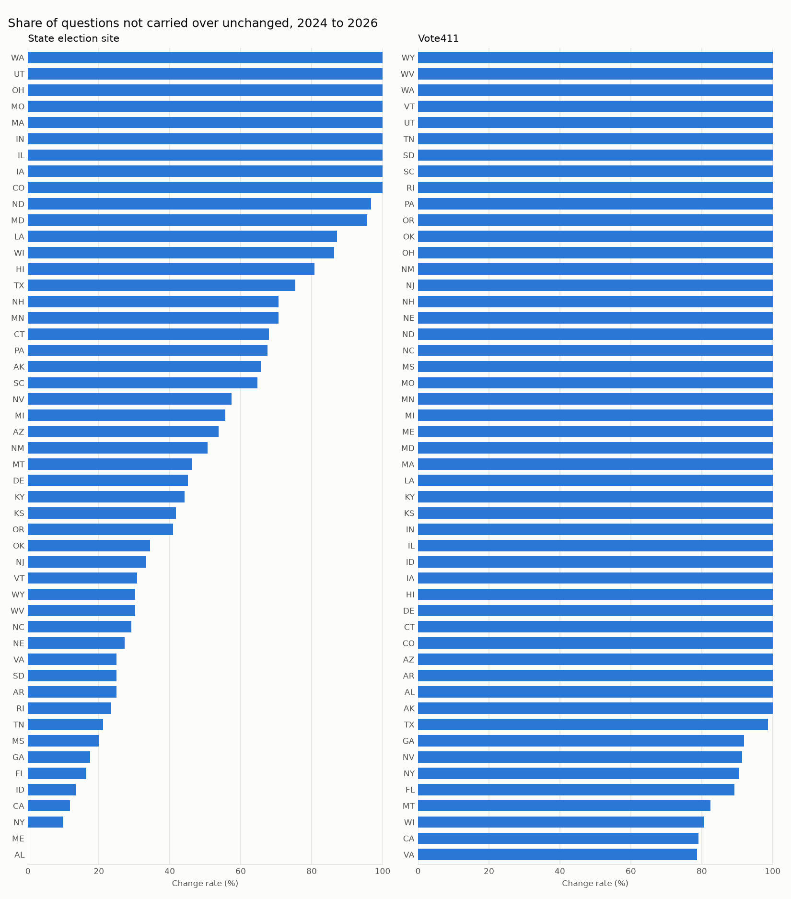
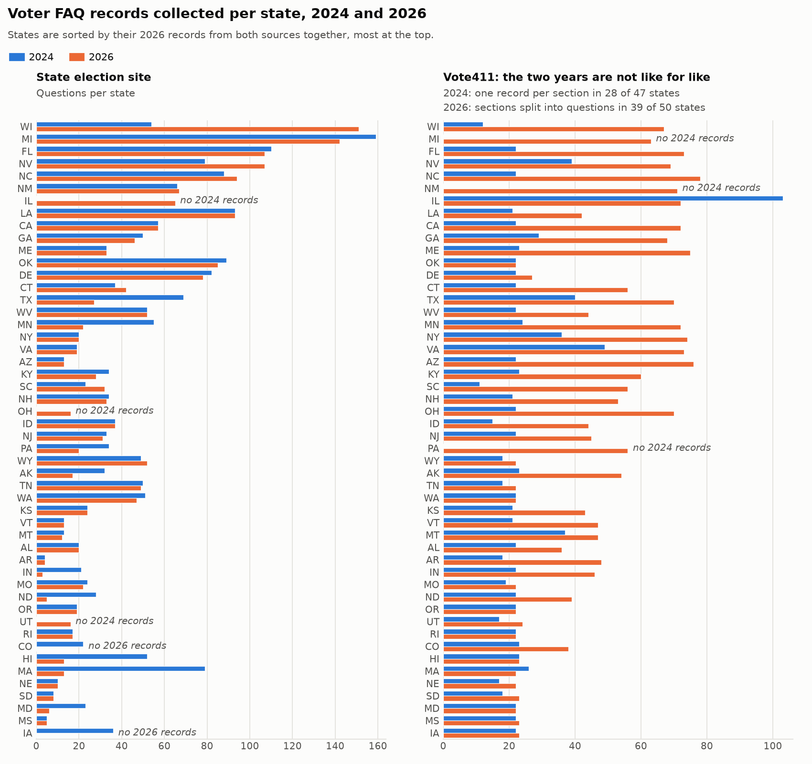
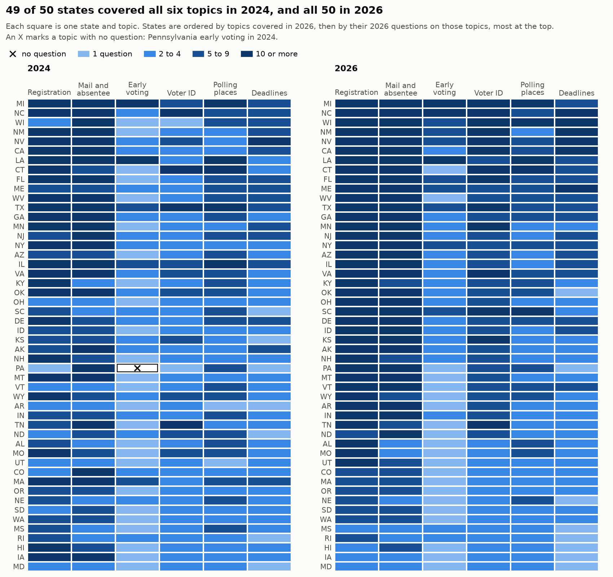

# U.S. Voter FAQs: 2024 and 2026

This project collects voter FAQs published during the 2026 election cycle from each state's official election website and Vote411.org. It builds them into a dataset matching the AI for Society Research Group's 2024 format, making it easy to compare how voter information changed within and across states.

The pipeline is designed to be reusable for future cycles. The code takes the election year as an input, so it can collect, build, and compare new data automatically. Most updates for a new cycle just require tweaking `sources.csv` (the source pages) and `settings.toml` (thresholds and rules), with no direct code edits.

The 2026 pages were downloaded right before the November 3 election, between October 22 and October 30. Every record includes the exact date and time it was downloaded.

## Results (2026 compared with 2024)

The 2026 dataset has 4,252 records from 50 states (1,892 from state sites, 2,360 from Vote411). The 2024 baseline has 3,183 (2,020 from state sites, 1,163 from Vote411). No state has been reviewed by a person yet, so these numbers are not final. All 50 rows in `data/2026/review.csv` are still pending.

| Question | Result | Keep in mind |
| ----- | ----- | ----- |
| How much did state election sites change? | In the median state, 22% of questions changed in a major way (38 states) | 12 states get no rate: 5 have no records in one of the two years, and 7 have under half as many 2026 records as 2024 |
| How much did Vote411 change? | In the median state, 55% changed in a major way (47 states) | Counted in whole sections in all but 3 states, so it can't be set beside the 22% |
| Do states cover the main voter topics? | 49 of 50 states cover all six topics in 2024, and all 50 do in 2026 | A topic is assigned by keywords in the question |



To read one bar, take Oregon's state site. It has 21 questions across both years. 5 changed in a major way (24%, the dark part) and 3 had minor edits (14%, the light part). A major change is a new question, a removed question, or an answer rewritten below 0.85 similarity.

States listed at the bottom have no rate, and the chart says why. Either the state has no records for that source in one of the two years, or it has under half as many 2026 records as 2024, which usually means the collection missed pages.



42 of 50 states have more Vote411 records in 2026. Most of that comes from counting, not from new content: the 2026 code splits each Vote411 section into its questions, while most 2024 records are whole sections (see the method table under [Prior Work (2024)](#prior-work-2024)).



A question counts toward a topic when its wording matches that topic's keywords, and questions from both sources are counted. Voter ID counts any mention of ID, including ID for registering. These six topics are not the eight topics found by the 2024 paper's topic model, so the two sets of numbers can't be compared.

### Browse every question

Every compared question or section is in `data/2026/analysis/comparison/pairs.csv` (3,824 rows), which is too big for GitHub to show as a table. These links open it as a table in the browser, with no install and no account:

- [All 3,824 rows](https://lite.datasette.io/?csv=https://github.com/CEASLEY803/voter-faqs-2026/blob/master/data/2026/analysis/comparison/pairs.csv#/data/pairs?_col=state&_col=source&_col=result&_col=question_2024&_col=question_2026&_facet=result&_facet=source&_size=20)
- [Oregon's state site](https://lite.datasette.io/?csv=https://github.com/CEASLEY803/voter-faqs-2026/blob/master/data/2026/analysis/comparison/pairs.csv#/data/pairs?state=Oregon&source=state+site&_col=result&_col=question_2024&_col=question_2026&_facet=result) (21 rows)
- [State-site answers that changed a lot](https://lite.datasette.io/?csv=https://github.com/CEASLEY803/voter-faqs-2026/blob/master/data/2026/analysis/comparison/pairs.csv#/data/pairs?source=state+site&result__contains=major+answer+change&_col=state&_col=question_2026&_col=answer_2024&_col=answer_2026&_size=20) (154 rows, with the 2024 and 2026 answers side by side)
- [State-site questions that are new in 2026](https://lite.datasette.io/?csv=https://github.com/CEASLEY803/voter-faqs-2026/blob/master/data/2026/analysis/comparison/pairs.csv#/data/pairs?source=state+site&result=new+question&_col=state&_col=question_2026&_col=answer_2026&_size=20) (427 rows)

The `result` column says in plain words what happened to each question, such as "same question, major answer change". Click the number at the start of a row to see that question with both years' answers in full. To see another state, open the Oregon link, type the state's name over "Oregon" in the filter box at the top (capitalized, such as Texas or New York), and press "Apply filters".

Known data problems are listed in the data quality report, which contains 122 findings in 7 categories at [`data/2026/quality/quality_summary.md`](data/2026/quality/quality_summary.md).

## Prior Work (2024)

The baseline 2024 dataset comes from the AI for Society Research Group's [election-dataset-us repository](https://github.com/ai4society/election-dataset-us/). This data is used strictly for comparison, and the new 2026 collections are kept in separate files.

For more context on the original project, there is a research paper titled [Do Voters Get the Information They Want? Understanding Authentic Voter FAQs in the US and How to Improve for Informed Electoral Participation](https://arxiv.org/abs/2412.15273). The authors provide their preferred paper citation in the original repository's [Citation section](https://github.com/ai4society/election-dataset-us/#citation). The exact version of the repository used for the 2024 data is recorded in `reference/baseline_provenance.json`.

A few states in 2024 had unique formatting. Texas's single file stores its records under the keys `metadata` and `data`, New Mexico's file stores its records as parallel lists under the state code `mx`, Delaware used `dl_qa.json`, and Massachusetts and Wisconsin named a website (such as `Voting-Mass.gov` or `elections.wi.gov`) instead of providing a URL in every record. The `datasets.py` script handles reading all of these so the rest of the pipeline treats every state equally.

The `data/2024/manifest.json` file (generated by `describe_dataset.py`) logs how each state's 2024 Vote411 records were originally structured so the comparison tool knows what to expect:

| 2024 Method | States | What the Records Look Like | 
| ----- | ----- | ----- | 
| `section_titles` | 28 | Entire Vote411 sections stored as a single record, with the title phrased as a question | 
| `mixed` | 15 | A mix of the above method and real questions | 
| `question_headings` | 3 (CA, GA, TX) | Actual questions extracted from inside the sections | 
| `none` | 3 (MI, NM, PA) | No 2024 Vote411 records exist | 
| `page_fragments` | 1 (IL) | Dates and fragments rather than actual questions | 

To force how a state is compared, add it under `[comparison.vote411_unit_overrides]` in `settings.toml`. Editing the manifest by hand does not last, because `describe_dataset.py` rewrites it.

## How Records Are Formatted

Every state file follows the 2024 layout, which includes the state code, question and answer counts, a contributor name, and a list of records. Here is what each record contains:

| Field | Meaning | 
| ----- | ----- | 
| `q` | The published question | 
| `a` | The published answer | 
| `s` | The source URL | 
| `t` | The exact time the page was downloaded | 

While some pages have clear Q&A pairs, others place useful information under headings that aren't phrased as questions. The Vote411 and South Carolina collectors save those separately as supporting records with `topic`, `kind`, and `content` fields, plus the usual source and time fields. Supporting records are not part of the combined dataset. They stay with the collection, in `<state>/<state>_supporting_content_vote411.json` inside each Vote411 batch folder and in `sc_supporting_content.json` inside each South Carolina run folder.

Vote411 sections are handled a bit differently. If a section doesn't have question headings, the build step stores the entire section as one record (using the title as `q` and the text as `a`). This mirrors the 2024 setup and ensures every state has Vote411 records in the combined dataset.

## How the Pipeline Works

One command, `run_pipeline.py`, runs every step for an election year. Because each step is its own script, individual pieces can be rerun as needed.

| Step | Script | What It Does | Output | 
| ----- | ----- | ----- | ----- | 
| Collect | `collect_vote411.py`, `snapshot_state_sites.py` | Downloads Vote411 and state pages listed in `sources.csv`. | `data/<year>/batches/`, `data/<year>/state_sites/` | 
| Check Vote411 | `validate_vote411_batch.py` | Validates extracted Vote411 records against the raw saved pages (runs with `--collect`). | `validation_report.json` in the batch folder | 
| Parse Pages | `parse_state_sites.py` | Transforms saved state pages into Q&A records. | `state_site_parse_report.json` in `combined/` | 
| Build | `build_dataset.py` | Merges state and Vote411 records into one 2024-formatted file per state. | `data/<year>/combined/` | 
| Check Quality | `quality_report.py` | Flags potential data issues, row by row. | `data/<year>/quality/` | 
| Review | `run_pipeline.py` | Sets up a CSV for manual approval of each state's data. | `data/<year>/review.csv` | 
| Compare | `compare_years.py` | Compares the current year against the baseline, source by source. | `data/<year>/analysis/comparison/` | 
| Analyze | `analyze_states.py` | Generates cross-state stats, rankings, topic coverage, and charts. | `data/<year>/analysis/` | 

## File Structure

| File or Folder | Content | 
| ----- | ----- | 
| `data/2024/` | Original baseline data, kept unchanged, plus `manifest.json`. | 
| `data/2026/runs/` | Individual collection runs kept to compare outputs after code changes. | 
| `data/2026/batches/` | Vote411 collection runs (earlier batches are kept to track extraction changes). | 
| `data/2026/state_sites/` | Unaltered, downloaded copies of state election websites. | 
| `data/2026/combined/` | The final dataset (one file per state), plus manifest and parse reports. | 
| `data/2026/quality/` | Data quality report for the dataset. | 
| `data/2026/review.csv` | Manual review status for each state. | 
| `data/2026/analysis/` | The comparison outputs, charts, and cross-state tables. | 
| `reference/` | Select original repo files and the recorded baseline version used. | 
| `sources.csv` | Master list of URLs to collect from. | 
| `settings.toml` | Core rules and thresholds for building and comparing data. | 
| `collect_sc.py` | The South Carolina collector and shared functions like reading `sources.csv`. | 
| `collect_vote411.py` | The Vote411 collector for selected states or all 50. | 
| `snapshot_state_sites.py` | Downloads state pages and imports manually saved pages. | 
| `validate_vote411_batch.py` | Verifies Vote411 results against sources. | 
| `parse_state_sites.py` | Main HTML parser, with site-specific rules chosen by hostname. | 
| `build_dataset.py` | Builds one year's combined dataset. | 
| `quality_report.py` | Writes the data quality report. | 
| `compare_years.py` | Compares two years state by state. | 
| `analyze_states.py` | Writes cross-state tables and charts. | 
| `run_pipeline.py` | Master script to run all steps for one year. | 
| `datasets.py` | Reads and writes yearly datasets, including 2024 layouts. | 
| `describe_dataset.py` | Writes a manifest for data this pipeline didn't build (like the 2024 data). | 
| `restore_baseline.py` | Recovers original data from the recorded repo version. | 
| `requirements.txt` | Python libraries needed to run the tools. | 
| `AI_USAGE.md` | Log of coding prompts and models used for transparency. | 

## Setup

Install Python 3.11 or newer, open a terminal, and go to the project folder. Create a virtual environment:

```
python -m venv .venv
```

Activate it based on the operating system:

| Terminal | Command | 
| ----- | ----- | 
| PowerShell | `.venv\Scripts\Activate.ps1` | 
| Command Prompt | `.venv\Scripts\activate.bat` | 
| macOS or Linux | `source .venv/bin/activate` | 

If PowerShell says that running scripts is disabled, use the Command Prompt command instead.

With the environment active, install the dependencies:

```
python -m pip install -r requirements.txt
```

The 2024 files are already included. If they ever need to be recovered without overwriting existing changes, run:

```
python restore_baseline.py
```

## Run the Whole Pipeline

```
python run_pipeline.py --year 2026
```

This uses the newest Vote411 batch that passed validation for all 50 states and the newest state-site batch. It rebuilds `data/2026/combined/`, writes a quality report, populates missing states in `review.csv`, compares 2026 with 2024, and writes the analysis. Running it twice on the same batches yields the same results; only the build time in `manifest.json` changes.

| Option | What It Does | 
| ----- | ----- | 
| `--collect` | Downloads everything first. If state pages refuse automated downloads, it writes a checklist and stops. | 
| `--baseline-year YEAR` | Compares with a year other than 2024. | 
| `--skip-build` | Reuses existing data in `data/<year>/combined/`. | 
| `--approved-only` | Analyzes only the states marked as approved in `review.csv` and writes to `analysis_approved/` instead of `analysis/`. | 
| `--vote411-batch PATH` / `--state-site-batch PATH` | Uses a specific data batch instead of the newest one. | 
| `--contributor "NAME"` | Sets the contributor name in the state files (default is Cole Easley). | 

## Review States

Automated checks cannot catch everything, so a manual review of each state is necessary. This means opening the state's file in `combined/` alongside its saved pages and the data quality report findings.

`review.csv` tracks progress with the statuses `pending`, `approved`, or `rejected`. An approved row requires a reviewer name and a date (YYYY-MM-DD). If one is missing, the pipeline stops with an error that names the line. You must fix the row and run it again.

To compare and analyze only the approved states:

```
python run_pipeline.py --year 2026 --skip-build --approved-only
```

## How the Comparison Works

The comparison matches the baseline year's questions directly to the current year's within the same source (state site with state site, Vote411 with Vote411). County websites or other organizational records are counted but excluded from matching.

Matching happens in two passes:

1. Exact matches are paired if the questions are identical once lowercased and stripped of punctuation.

2. Remaining pairs are scored from 0 to 1 using Python's `difflib.SequenceMatcher`. Pairs scoring at or above the `reworded_threshold` (0.8) are matched, prioritizing the highest scores.

Questions are assigned one of four statuses:

| Status | Meaning | 
| ----- | ----- | 
| `same` | Identical after formatting cleanup | 
| `reworded` | Close enough to hit the 0.8 threshold | 
| `new` | Found in the current year, but not the baseline | 
| `removed` | Found in the baseline, but missing this year | 

Next, the answers for matched pairs are checked. If they are identical, they are marked unchanged. For the rest, a score of 0.85 or higher counts as a "minor edit" (like a date change or added link), while anything lower is a "major change."

Rates are calculated for each state. The minor edit rate counts matched pairs with a minor answer edit, plus reworded questions whose answers are unchanged or only lightly edited. The major change rate counts major edits plus new and removed questions. A state that added many questions will therefore show a high major change rate even if none of its old answers changed. A state with no records for a source in one of the two years gets no rate. Neither does a state whose record count for a source is under half of the baseline year's count (`below_baseline_ratio` in `settings.toml`), because most of its "removed" questions are questions the collection missed. The reason is written in the `change_rate_note` columns of `per_state.csv` and shown on the chart.

California, Georgia, and Texas are compared question-by-question because both years used actual question headings. The other 47 states are compared by section because their layouts differ between the two years. Illinois is set to section by an override, and Michigan, New Mexico, and Pennsylvania had no 2024 Vote411 records to compare against. The `vote411_unit` setting in `settings.toml` manages this logic.

## Settings

`settings.toml` holds the thresholds and rules. Edit this file instead of the code.

| Section | What It Controls | 
| ----- | ----- | 
| `[comparison]` | Vote411 comparison unit (`vote411_unit`), thresholds, and boilerplate repetition rules | 
| `[comparison.vote411_unit_overrides]` | State-specific rules taking priority (e.g., Illinois is set to `section`) | 
| `[non_faq]` and `[[non_faq_rules]]` | Rules that strip out elements like contact boxes when building datasets | 
| `[quality]` | Thresholds for extremely short/long answers or low record counts. The low-count threshold also decides which states get no change rate | 
| `[[vote411_sections]]` | Keyword fallbacks for categorizing older 2024 Vote411 data without section labels | 
| `[[topics]]` | Keyword rules that sort questions into the six topics on the topic coverage chart, with phrases to ignore | 

## Outputs

| Path (under `data/<year>/`) | Content | 
| ----- | ----- | 
| `combined/<state>_qa.json` | State site records, then Vote411 questions, then Vote411 sections | 
| `combined/manifest.json` | Batches used, extraction methods, and flagged pages | 
| `combined/state_site_parse_report.json` | Record counts and flags for manual checks | 
| `combined/dropped_records.json` | Records dropped by the non-FAQ rules | 
| `quality/quality_report.csv` | Line-by-line quality findings | 
| `quality/quality_summary.md` | Summary of findings by category | 
| `review.csv` | Manual review tracker | 
| `analysis/comparison/<state>.json` | Every compared question or section, with status and scores | 
| `analysis/comparison/summary.csv` | Counts for each state and source | 
| `analysis/comparison/pairs.csv` | Every compared question or section in one file, by full state name, with both years' questions and answers | 
| `analysis/per_state.csv` | Cross-state stats, coverage, and rankings | 
| `analysis/topics.csv` | Topic coverage by state | 
| `analysis/rankings.csv` | States ranked by topic coverage and major change rate | 
| `analysis/charts/` | Visuals like `questions_per_state.png` and `topic_coverage.png` | 

For a quick look at the state numbers, open `analysis/rankings.csv` (12 columns) before `analysis/per_state.csv` (54 columns). Rates in both files are fractions, so 0.22 means 22%.

A page gets flagged when the parser finds no records on it, or fewer than half of the records the baseline year had for the same URL. A flag means the page needs a look, not that it is strictly broken.

## Start a New Election Cycle

To run this for an upcoming cycle like 2028:

1. Open `sources.csv` to ensure the URLs still open the correct pages. Update any that moved and log the old URL in the notes.

2. Collect, build, and compare in one run:

   ```
   python run_pipeline.py --year 2028 --baseline-year 2026 --collect
   ```

3. If the run stops because pages refused scripted downloads, save them by hand (see "Save pages by hand") using the provided batch folder, then rerun without the `--collect` flag.

4. Review `data/2028/quality/quality_summary.md` and check flagged pages.

5. Review each state in `review.csv` and run the final comparison with `--skip-build --approved-only`.

## Source List

`sources.csv` lists every page the collectors use. A state can have multiple `state` rows if FAQs are spread across pages, but only one `vote411` row.

To change a source, update the URL in `sources.csv` and keep the old URL in the notes column for traceability.

## Run the Collectors

`run_pipeline.py --collect` handles the collectors automatically, but they can be run individually. Supply `--year` (defaults to the current year otherwise).

Collect South Carolina from both SC Votes and Vote411:

```
python collect_sc.py
```

Collect Vote411 for specific states (e.g., Georgia and Ohio):

```
python collect_vote411.py ga oh
```

Collect Vote411 for all 50 states:

```
python collect_vote411.py --all
```

Failed states are logged in `batch_manifest.json` and the script continues. Retries can be run by passing the failed state codes into a new run.

## Save State Election Website Pages

State websites are saved directly before being turned into FAQ records to preserve copies of the original pages.

Save all pages in `sources.csv`:

```
python snapshot_state_sites.py
```

To resume an existing batch and fetch only unsaved pages:

```
python snapshot_state_sites.py --batch "PATH_TO_BATCH_FOLDER"
```

## Save Pages By Hand

If sites block automated scripts, they can be saved manually. Generate a checklist of failed pages:

```
python snapshot_state_sites.py --batch "PATH_TO_BATCH_FOLDER" --checklist
```

This creates `manual_saves/checklist.csv` with each page's URL and the file name to save it under. For each page on the checklist:

1. Open the URL in a browser and wait for the page to finish loading.

2. Press Ctrl+S and choose "Webpage, HTML Only".

3. Save it in `manual_saves/` using the specified filename.

Then import them back into the batch:

```
python snapshot_state_sites.py --batch "PATH_TO_BATCH_FOLDER" --import-manual
```

## Reuse Saved Pages

When testing code changes, the outputs can be run on locally saved pages rather than re-downloading them.

For a saved South Carolina run:

```
python collect_sc.py --from-run "PATH_TO_SAVED_RUN"
```

For a saved Vote411 batch:

```
python collect_vote411.py --all --from-batch "PATH_TO_BATCH_FOLDER"
```

The new output goes into a separate folder, while the source pages and download times are kept unchanged.

## Check a Vote411 Batch

```
python validate_vote411_batch.py "PATH_TO_BATCH_FOLDER"
```

This checks required fields, record counts, and compares text against source sections to find lost or repeated data. Results are saved in the batch folder as `validation_report.json`. The build step only uses a batch whose validation report passed for all 50 states.

## Limits and Review

Passing automated checks does not mean every record parsed perfectly. The HTML parser grabs text ending in a question mark, which can occasionally pull in generic web text like "How Can We Help You?" (the non-FAQ rules help drop these).

The comparison logic evaluates spelling rather than semantic meaning. For example, "How do I get an absentee ballot?" and "How can I request a mail-in ballot?" score below the rewording threshold, logging as one "removed" and one "new" question.

Finally, a download time reflects when the text was scraped, not when it was originally published by the state.

## License and Credit

New code and documentation in this project use the MIT license in `LICENSE`, copyright 2026 Cole Easley.

Material included from the original 2024 project keeps its MIT license and copyright notice in `reference/LICENSE`, copyright 2024 AI for Society Research Group. The state web pages themselves may have their own copyright rules that this MIT license does not override.