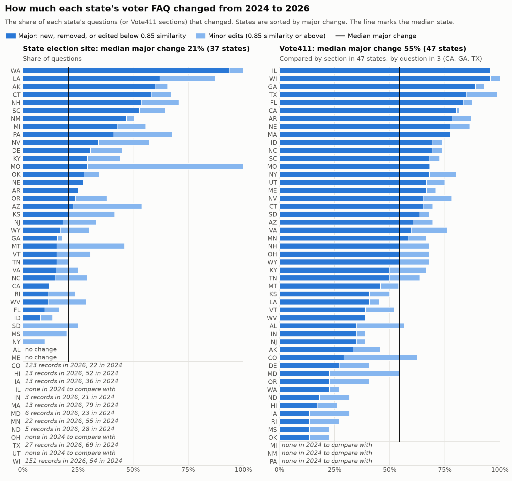

# VOICE: U.S. Voter FAQs Collection and Analysis Engine

Basically, this project scrapes voter FAQs from official state election websites and Vote411.org for the 2026 election. It formats that data to match the AI for Society Research Group's 2024 dataset, and then runs a comparison to see exactly how each state's voter information changed between the two elections. 

## Why

Voter FAQs answer the biggest questions voters have, like how to register, where to vote, and what ID to bring. The 2024 dataset grabbed these answers for the last election. This project grabs them for 2026 so we can see what shifted. 

It is also set up so that an IT person or future student can easily run the pipeline again for 2028 without having to rewrite the codebase.

## What it found

The 2026 dataset pulled 4,388 records across all 50 states (2,028 from state sites, 2,360 from Vote411). I saved these pages in the weeks leading up to the November 3 election. Keep in mind, nobody has manually reviewed every state yet, so these numbers aren't final.

| Question | Result | Keep in mind |
| ----- | ----- | ----- |
| How much did state election sites change? | In the median state, 21% of questions had major changes (37 states) | 13 states don't have a rate: 3 didn't have 2024 records, 8 had under half as many 2026 records as 2024, and 2 had over twice as many |
| How much did Vote411 change? | In the median state, 52% had major changes (44 states) | I had to count these in whole sections for almost every state, so you can't really compare this directly against the 21% above |
| Do states cover the main voter topics? | 49 of 50 states covered all six topics in 2024. All 50 do in 2026 | The script assigns topics just based on keyword matching in the question |



How to read the chart: Look at Oregon's state site. It has 21 questions between both years. 5 of them changed in a major way (24%, dark blue) and 3 had minor edits (14%, light blue). A major change means the state added a new question, deleted an old one, or changed the answer by more than a small edit (below 0.85 similarity). 

If a state is listed at the bottom without a bar, the chart will tell you why it was skipped. 

I put every compared question into one massive table you can filter in your browser: [browse all 3,949 rows here](https://lite.datasette.io/?csv=https://github.com/CEASLEY803/voter-faqs-2026/blob/master/data/2026/analysis/comparison/pairs.csv&metadata=https://raw.githubusercontent.com/CEASLEY803/voter-faqs-2026/master/data/2026/analysis/comparison/pairs_metadata.json#/data/pairs?_col=state&_col=source&_col=result&_col=question_2024&_col=question_2026&_facet=result&_facet=source&_size=20).

For the rest of the charts, more links, and a rundown of the data's limitations, check out the [technical description](docs/TechnicalDescription.md#results-in-detail).

## How to run it

I built it so one command handles the whole pipeline. It scrapes the pages, builds the JSON records, checks for data problems, compares it against the baseline year, and generates the charts. 

If you wanted to collect 2028 and compare it to 2026, you'd just run:
```
python code/run_pipeline.py --year 2028 --baseline-year 2026 --collect
```

You shouldn't need to touch the Python code for a new cycle. Just update `sources.csv` with the new URLs and tweak the thresholds in `settings.toml`. The full setup guide and command list are in the [technical description](docs/TechnicalDescription.md#getting-started--how-to-run).

## Where things are

| Folder or file | What's in it |
| ----- | ----- |
| [`docs/`](docs/) | The technical description (how it works and how to run it). |
| [`code/`](code/) | The Python scripts. `run_pipeline.py` runs everything. |
| [`data/2024/`](data/2024/) | The 2024 dataset. (Untouched). |
| [`data/2026/`](data/2026/) | The saved HTML pages, datasets, quality reports, and charts. |
| `sources.csv`, `settings.toml` | The URLs to scrape, plus the rules/thresholds. |
| [`reference/`](reference/) | Files kept from the original 2024 project. |
| [`AI_USAGE.md`](AI_USAGE.md) | Log of the prompts and AI models I used. |

## Credits

I (Cole Easley) built this for a CSCE 498 independent study at the University of South Carolina in Fall 2026, mentored by [Dr. Biplav Srivastava](https://github.com/biplav-s) of the [AI for Society Research Group](https://github.com/ai4society).

**Data:** The 2024 baseline data comes from the group's [election-dataset-us](https://github.com/ai4society/election-dataset-us/) repository. I pulled the 2026 data from the 50 state election websites listed in `sources.csv` and from [Vote411](https://www.vote411.org/).

**Software:** Python with [Requests](https://requests.readthedocs.io/), [Beautiful Soup](https://www.crummy.com/software/BeautifulSoup/), [pypdf](https://pypdf.readthedocs.io/), and [Matplotlib](https://matplotlib.org/). [Datasette Lite](https://lite.datasette.io/) is what displays the CSV in the browser. I used the [Internet Archive](https://web.archive.org/) as a fallback for state sites that blocked the scraper.

**Generative AI:** I used generative AI for the coding: OpenAI Codex (GPT-6) and Claude Code (Claude Opus 5.5 and Claude Fable 5.2). The prompts and models are logged in [`AI_USAGE.md`](AI_USAGE.md). Claude also helped organize and draft this README and the technical description, which I then rewrote in my own words.

### Citation

If you find this work useful, please cite the paper behind the 2024 dataset:

```
@inproceedings{ai4s2024-voterfaqsUS,
  title={Do Voters Get the Information They Want? Understanding Authentic Voter FAQs in the US and How to Improve for Informed Electoral Participation},
  author={Vipula Rawte and Deja N Scott and Gaurav Kumar and Aishneet Juneja and Bharat Sowrya Yaddanapalli and Biplav Srivastava},
  booktitle={TrustNLP: Fifth Workshop on Trustworthy Natural Language Processing, 2025 Annual Conference of the North American Chapter of the Association for Computational Linguistics (NAACL 2025), https://2025.naacl.org/},
  year={2025}
}
```

### Related data

- [election-dataset-us](https://github.com/ai4society/election-dataset-us/): the 2024 U.S. voter FAQs this project compares against.
- [election-dataset](https://github.com/ai4society/election-dataset/): voter FAQs from leading global democracies.

### License

New code and documentation in this project use the MIT license in `LICENSE`, copyright 2026 Cole Easley.

Material included from the 2024 project keeps its MIT license and copyright notice in `reference/LICENSE`, copyright 2024 AI for Society Research Group. (Note: The state web pages themselves might have their own copyright rules that the MIT license doesn't override).