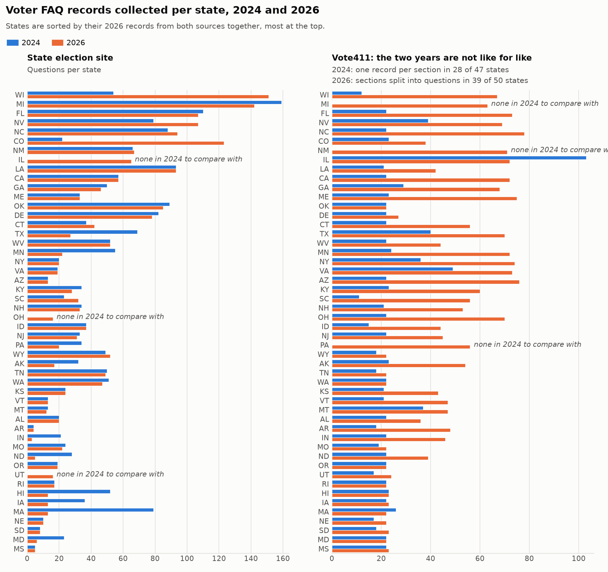
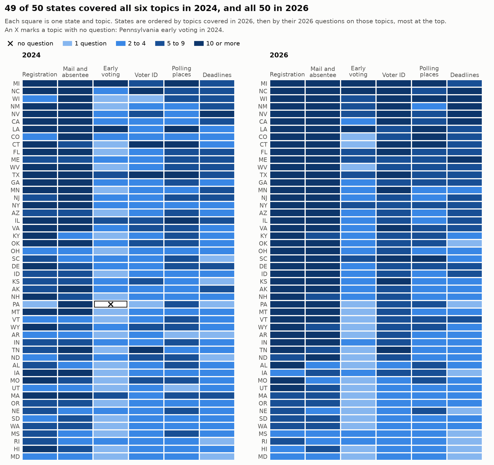

# Technical Description

This doc covers the technical details behind the project's [README](../README.md): the rest of the numbers, how the pipeline and comparison actually work, and how to get everything running on your own machine.

- [Results in detail](#results-in-detail)
- [Under the hood](#under-the-hood)
- [How to run it](#getting-started--how-to-run)

## Results in detail

The main numbers and the change chart are in the [README](../README.md#what-it-found). To break it down: the 2024 dataset has 3,183 records (2,020 from state sites, 1,163 from Vote411). The 2026 dataset has 4,388 (2,028 from state sites, 2,360 from Vote411).

I downloaded the Vote411 pages on October 22, 2026, and the state pages on October 29 and 30. Eleven state pages blocked the scraper, so I pulled those from the Internet Archive (dated between September 29 and November 2). Every record logs the exact date and time it was saved.

On the change chart, you'll see some states at the bottom with no rate. Usually, this means one year had data that the other year completely missed (either 0 records, under half, or over twice as many). In those cases, comparing them just measures how good the web scraper was that year, not how the state actually changed its FAQ.



42 out of 50 states have more Vote411 records in 2026. This is mostly just a counting difference, not a massive spike in new info. The 2026 scraper splits Vote411 sections into individual questions, while the 2024 version mostly grabbed whole sections at once (see [Prior Work (2024)](#prior-work-2024)).



A question gets tagged with a topic if its wording matches that topic's keywords. (For example, "Voter ID" triggers on any mention of ID, including registering to vote). Note: The 2024 research paper used a topic model to find eight topics. I used a strict keyword system for six topics, so you can't compare my topic numbers directly against the original paper's numbers.

### Browse every question

Every compared question/section is sitting in `data/2026/analysis/comparison/pairs.csv` (3,949 rows). It's way too big for GitHub's default viewer, so I set up these Datasette links so you can view and filter it right in your browser (no account or install needed):

- [All 3,949 rows](https://lite.datasette.io/?csv=https://github.com/CEASLEY803/voter-faqs-2026/blob/master/data/2026/analysis/comparison/pairs.csv&metadata=https://raw.githubusercontent.com/CEASLEY803/voter-faqs-2026/master/data/2026/analysis/comparison/pairs_metadata.json#/data/pairs?_col=state&_col=source&_col=result&_col=question_2024&_col=question_2026&_facet=result&_facet=source&_size=20)
- [Oregon's state site](https://lite.datasette.io/?csv=https://github.com/CEASLEY803/voter-faqs-2026/blob/master/data/2026/analysis/comparison/pairs.csv&metadata=https://raw.githubusercontent.com/CEASLEY803/voter-faqs-2026/master/data/2026/analysis/comparison/pairs_metadata.json#/data/pairs?state=Oregon&source=state+site&_col=result&_col=question_2024&_col=question_2026&_facet=result) (21 rows)
- [State-site answers that changed a lot](https://lite.datasette.io/?csv=https://github.com/CEASLEY803/voter-faqs-2026/blob/master/data/2026/analysis/comparison/pairs.csv&metadata=https://raw.githubusercontent.com/CEASLEY803/voter-faqs-2026/master/data/2026/analysis/comparison/pairs_metadata.json#/data/pairs?source=state+site&result__contains=major+answer+change&_col=state&_col=question_2026&_col=answer_2024&_col=answer_2026&_facet=result&_size=20) (155 rows, with the 2024 and 2026 answers side by side)
- [State-site questions that are new in 2026](https://lite.datasette.io/?csv=https://github.com/CEASLEY803/voter-faqs-2026/blob/master/data/2026/analysis/comparison/pairs.csv&metadata=https://raw.githubusercontent.com/CEASLEY803/voter-faqs-2026/master/data/2026/analysis/comparison/pairs_metadata.json#/data/pairs?source=state+site&result=new+question&_col=state&_col=question_2026&_col=answer_2026&_facet=result&_size=20) (552 rows)

### Known Issues & Limits

The data isn't perfect. I logged 151 potential data problems across 10 categories in [`data/2026/quality/quality_summary.md`](../data/2026/quality/quality_summary.md). 

A few things to keep in mind:
* Just because a script passes automated checks doesn't mean it parsed the page perfectly. The HTML parser grabs text ending in a question mark, which sometimes accidentally pulls in generic website junk like "How Can We Help You?" (I added some non-FAQ rules to help filter these out).
* The comparison logic looks at *spelling*, not semantic meaning. So "How do I get an absentee ballot?" and "How can I request a mail-in ballot?" are too different for the system to recognize as the same question. It'll log the first one as "removed" and the second as "new."
* The download timestamp is just when the Python script scraped the page, not when the state actually published the information.

## Under the Hood

### How the Pipeline Works

I set this up so `run_pipeline.py` handles everything for a given election year in one go. All the scripts live in `code/`. Because each step is its own file, you can easily tinker with or rerun individual pieces.

| Step | Script | What It Does | Output | 
| ----- | ----- | ----- | ----- | 
| Collect | `collect_vote411.py`, `snapshot_state_sites.py` | Downloads Vote411 and state pages listed in `sources.csv`. If a state blocks the download, it falls back to a pre-election Internet Archive copy. | `data/<year>/batches/`, `data/<year>/state_sites/` | 
| Check Vote411 | `validate_vote411_batch.py` | Double-checks extracted Vote411 records against the raw saved pages. | `validation_report.json` in the batch folder | 
| Parse Pages | `parse_state_sites.py` | Turns the raw HTML state pages into actual Q&A records. | `state_site_parse_report.json` in `dataset/` | 
| Build | `build_dataset.py` | Merges state and Vote411 records into one JSON file per state. | `data/<year>/dataset/` | 
| Check Quality | `quality_report.py` | Flags potential data issues, row by row. | `data/<year>/quality/` | 
| Review | `run_pipeline.py` | Generates a CSV so someone can manually approve each state's data. | `data/<year>/review.csv` | 
| Compare | `compare_years.py` | Compares the current run against the baseline year. | `data/<year>/analysis/comparison/` | 
| Analyze | `analyze_states.py` | Crunches the cross-state stats, topic coverage, and spits out the charts. | `data/<year>/analysis/` | 

### Prior Work (2024)

The baseline 2024 dataset comes from the AI for Society Research Group's [election-dataset-us repository](https://github.com/ai4society/election-dataset-us/). I only use it for comparison. All the new 2026 data gets built into completely separate files so we don't accidentally overwrite anything.

If you want the academic context behind the 2024 data, check out their paper: [Do Voters Get the Information They Want?](https://arxiv.org/abs/2412.15273) (citation is in the [README](../README.md#citation)). The exact repo version I used is logged in `reference/baseline_provenance.json`.

The 2024 data had some weird quirks. Texas hid its records inside `metadata` and `data` keys; New Mexico grouped theirs under `mx`; Delaware used a weird filename; and Mass/Wisconsin used hostnames instead of actual URLs. The `datasets.py` script handles all of these edge cases under the hood so the rest of the pipeline doesn't break.

The comparison tool uses `data/2024/manifest.json` (generated by `describe_dataset.py`) to figure out how each state formatted its 2024 Vote411 data:

| 2024 Method | States | What the Records Look Like | 
| ----- | ----- | ----- | 
| `section_titles` | 28 | Entire Vote411 sections stored as a single record. | 
| `mixed` | 15 | A mix of the above and real questions. | 
| `question_headings` | 3 (CA, GA, TX) | Actual questions extracted properly. | 
| `none` | 3 (MI, NM, PA) | Didn't have any 2024 Vote411 records. | 
| `page_fragments` | 1 (IL) | A mess of dates and fragments. | 

If you need to force the comparison tool to handle a state differently, edit `[comparison.vote411_unit_overrides]` in `settings.toml`. (Don't manually edit the manifest, because `describe_dataset.py` will just overwrite your changes anyway).

### How Records Are Formatted

Every state file mirrors the 2024 layout: state code, question/answer counts, contributor name, and the actual records. 

| Field | Meaning | 
| ----- | ----- | 
| `q` | The published question | 
| `a` | The published answer | 
| `s` | The source URL | 
| `t` | The exact time the scraper downloaded the page | 

### How the Comparison Works

The script matches the 2024 questions to the current year's questions, keeping state sites separate from Vote411. 

Here is how the matching logic works:
1. **Pass 1 (Exact):** Strips punctuation, lowercases everything, and pairs up exact matches.
2. **Pass 2 (Fuzzy):** Uses Python's `difflib.SequenceMatcher` to score whatever is left from 0 to 1. If a pair scores at or above `reworded_threshold` (0.8), they get matched.

Questions get tagged with one of four statuses: `same`, `reworded`, `new`, or `removed`.

Once the questions are matched, it checks the answers. An answer similarity score of 0.85+ is a "minor edit" (like they updated a date or a link). Anything lower is a "major change."

### Settings

Don't dig into the Python code to change rules. Just edit `settings.toml`.

| Section | What It Controls | 
| ----- | ----- | 
| `[comparison]` | Vote411 comparison logic and boilerplate rules. | 
| `[comparison.vote411_unit_overrides]` | State-specific overrides (like forcing Illinois to `section`). | 
| `[non_faq]` and `[[non_faq_rules]]` | Filters out junk text like "Contact Us" boxes. | 
| `[quality]` | Thresholds for flagging weirdly short/long answers or abnormal record counts. | 
| `[archive]` | How many days before election day an Internet Archive fallback is allowed to be. | 
| `[github]` | Repo/branch info for the Datasette browser link. | 
| `[[vote411_sections]]` | Keyword fallbacks for categorizing the messy 2024 Vote411 data. | 
| `[[topics]]` | Keyword rules to bucket questions into the six main topics. | 

### File Structure

Here is where everything lives. I tried to keep it pretty self-evident.

| File or Folder | Content | 
| ----- | ----- | 
| `data/2024/` | Original baseline data. Untouched. | 
| `data/2026/batches/` | Vote411 raw collection runs. | 
| `data/2026/state_sites/` | The raw, downloaded HTML copies of state websites. | 
| `data/2026/dataset/` | The final JSON datasets for the current year. | 
| `data/2026/analysis/` | The comparison outputs, charts, and CSVs. | 
| `docs/` | This document. | 
| `sources.csv` | The master list of URLs the scraper pulls from. | 
| `settings.toml` | All the core rules and thresholds. | 
| `code/` | All the Python scripts (see the pipeline table above). | 

## Getting Started / How to Run

### Setup

You'll need Python 3.11+. Open a terminal in the project folder and set up a virtual environment:

```
python -m venv .venv
```

Activate it:

| Terminal | Command | 
| ----- | ----- | 
| PowerShell | `.venv\Scripts\Activate.ps1` | 
| Command Prompt | `.venv\Scripts\activate.bat` | 
| macOS / Linux | `source .venv/bin/activate` | 

*(If PowerShell yells at you about running scripts, just use Command Prompt).*

Install the dependencies:

```
python -m pip install -r requirements.txt
```

If you ever accidentally wreck the 2024 baseline files, just run this to put them back:

```
python code/restore_baseline.py
```

### Run the Whole Pipeline

```
python code/run_pipeline.py --year 2026
```

This uses the most recent successful data batches, rebuilds `data/2026/dataset/`, generates the quality report, updates `review.csv`, runs the comparison against 2024, and spits out the charts. It's completely repeatable. 

When it finishes, it'll print a list of files to check out in your terminal.

**Useful flags:**
* `--collect`: Forces it to re-download everything from the web first.
* `--baseline-year YEAR`: Compare against something other than 2024.
* `--skip-build`: Skips the build step and just analyzes whatever is currently in the dataset folder.
* `--approved-only`: Only analyzes states you've manually marked as `approved` in `review.csv`.

### Reviewing States

The scripts aren't perfect, so you have to manually approve the states. Check the state's generated file in `dataset/` against the actual saved HTML page and the quality report. 

Track your progress in `review.csv` (`pending`, `approved`, `rejected`). If you mark it `approved`, you *must* include your name and the date (YYYY-MM-DD), or the pipeline will crash and tell you to fix it.

### How to run this for the next election (e.g. 2028)

I set this up so you shouldn't have to rewrite the code for the next cycle. 

1. Run the whole thing and tell it to use 2026 as the baseline:
   ```
   python code/run_pipeline.py --year 2028 --baseline-year 2026 --collect
   ```
2. If states redesigned their websites and the old links are dead, the run still finishes. Open `data/2028/quality/quality_summary.md`. It lists every dead link and tries to suggest replacements.
3. Update `sources.csv` with the new working URLs (leave the old URLs in the notes column so we don't lose track of them).
4. Download just the fixed pages into your current batch, then rerun the pipeline:
   ```
   python code/snapshot_state_sites.py --batch "PATH_TO_BATCH_FOLDER"
   python code/run_pipeline.py --year 2028 --baseline-year 2026
   ```

### Saving Pages Manually

Some states have extreme anti-bot protection and will just block the Python scraper. To save them manually:

1. Generate a checklist:
   ```
   python code/snapshot_state_sites.py --batch "PATH_TO_BATCH_FOLDER" --checklist
   ```
2. Open `manual_saves/checklist.csv`. It tells you the URL and what to name the file.
3. Open the URL in your browser, hit Ctrl+S, and save it as "Webpage, HTML Only" into the `manual_saves/` folder using the exact filename from the checklist.
4. Import them back into the pipeline:
   ```
   python code/snapshot_state_sites.py --batch "PATH_TO_BATCH_FOLDER" --import-manual
   ```